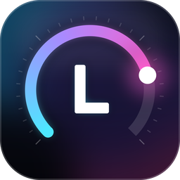

# Lumen HUD

**A system monitor built for the little screen in or beside your PC.** Lumen HUD turns an 8.8" bar, a HYTE Y70 touch panel, a spare tablet-sized display or just the edge of your main monitor into a live instrument panel: temperatures and load, FPS and frame time, what's playing, the weather, your AI plan limits, a game launcher and your RGB lights, in a look you choose or build yourself.

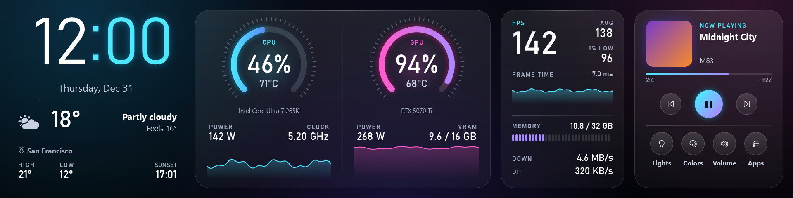

Windows 10 1809 or later, x64. One self-contained `LumenHUD.exe`, no installer and no .NET runtime to install. Sensors come from [HWiNFO](https://www.hwinfo.com/).

**[Download the latest release](https://github.com/kasualty21/Pulsewave-HUD/releases/latest)** · [Change log](src/CHANGELOG.md) · [What's planned](docs/ROADMAP.md)

> Lumen HUD was called Pulsewave until version 0.14; settings carry over by themselves.
>
> Every picture on this page is rendered by Lumen HUD itself with built-in sample readings, not captured from anyone's desktop.

## Contents

- [One screen, many faces](#one-screen-many-faces)
- [Lumen, the baseline look](#lumen-the-baseline-look)
- [Any screen shape](#any-screen-shape)
- [Legacy themes](#legacy-themes)
- [Recolor anything](#recolor-anything)
- [Touch pages](#touch-pages)
- [What it can show](#what-it-can-show)
- [It changes with what you're doing](#it-changes-with-what-youre-doing)
- [Build your own theme](#build-your-own-theme)
- [Getting started](#getting-started)
- [Privacy and safety](#privacy-and-safety)
- [Building from source](#building-from-source)
- [Project layout](#project-layout)

## One screen, many faces

The same bar in Lumen and some of the legacy themes you can import. Switch by tray menu, a swipe, a hotkey, a timed playlist, or let the HUD pick for you when a game starts.

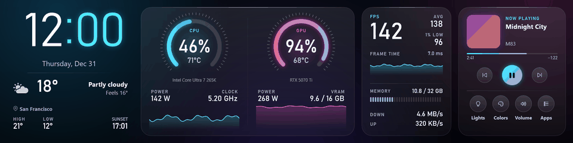

## Lumen, the baseline look

Lumen is the HUD's signature style: light on near-black with an aurora behind it, see-through glass, tick-ring gauges with glowing arcs, DIN numerals and segmented meters. It comes in three versions, each made for a job.

**Lumen Lifestyle** (pictured at the top), the base theme, is the all-rounder: clock and weather, CPU and GPU, FPS and frame time, memory and network, now playing and quick toggles.

**Lumen Gaming** puts the game first. Live FPS is the hero number, with the session average, 1% low and a frame-time chart (a dashed line marks 60 FPS, and the trace turns amber above 33 ms). Beside it: the game's cover, how long you've played today and this week, peak temperatures, and CPU and GPU cards that say when a thermal or power limit is holding them back.

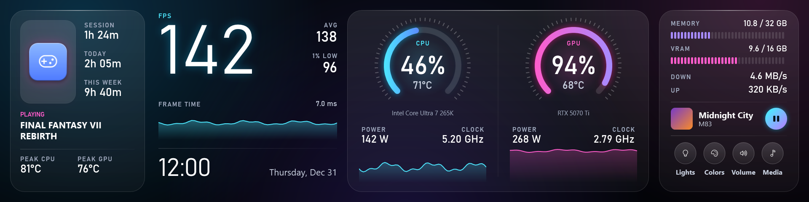

**Lumen Productivity** is for work: a timer or stopwatch on an instrument dial with Pomodoro presets, your Claude Code and Codex plan limits with when they reset, a compact system card with the drive, and a now-playing strip.

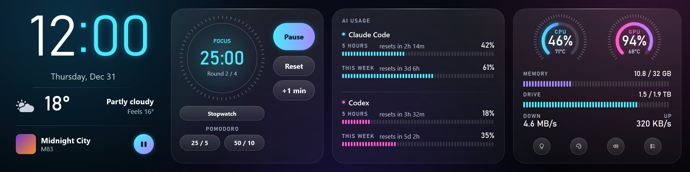

All three also come as tall layouts for a vertical screen, where the all-round and Productivity versions stack hours over minutes as a huge clock:

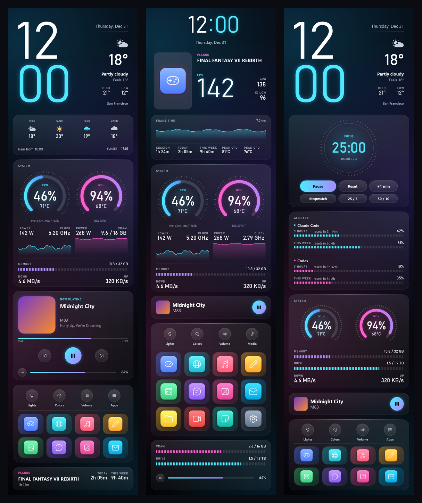

## Any screen shape

Lumen HUD was born on a 1920×480 bar, but a theme can be any size. Layouts cover:

| Screen | Size | Notes |
|---|---|---|
| 8.8" bar | 1920×480 | The original. Lumen's three, plus twenty-four legacy themes. |
| HYTE Y70 Touch Infinite, upright | 682×2560 | Lumen's three columns, plus twelve legacy ones. Tray → Rotate HUD runs them on a panel Windows shows sideways. |
| HYTE Y70, landscape | 2560×682 | Infinity (legacy). |
| Tablets and spare monitors | 1920×1200 | Desk Tablet and Command Deck (legacy). |
| No second display | a strip of your main monitor | Tray → Dock to screen edge reserves 15–40% along any edge, like the taskbar. |

A theme that doesn't match the screen is letterboxed rather than stretched, and the gallery can filter to the shapes that fit.

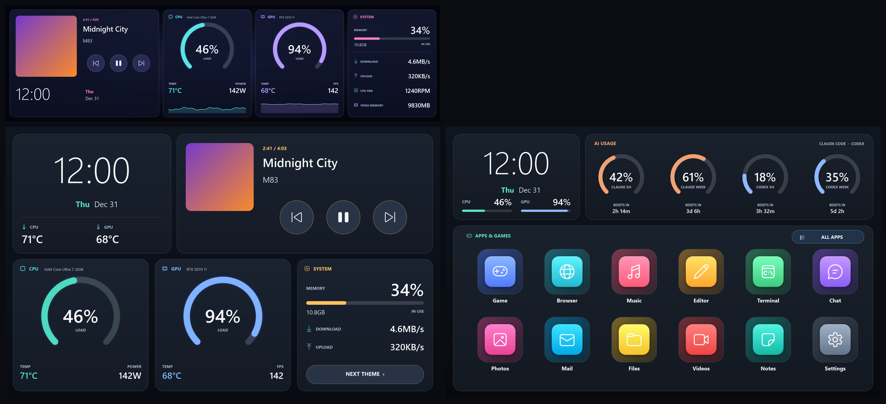

## Legacy themes

Lumen's six templates are the built-in themes; each is read-only and **Duplicate** makes a copy you can edit. The 39 themes from before Lumen (glass cards, sci-fi HUDs, gauges, a terminal, synthwave, a vinyl player, a launcher, light and monochrome themes, and the Halo and One UI families) are kept as legacy themes: **Themes → Import → Legacy theme** copies one into your own themes. A legacy theme you were already using is imported for you when you upgrade.

The legacy bar themes:

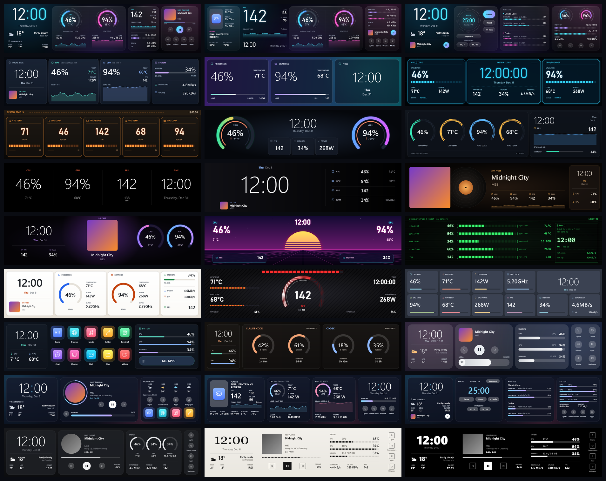

The legacy vertical themes:

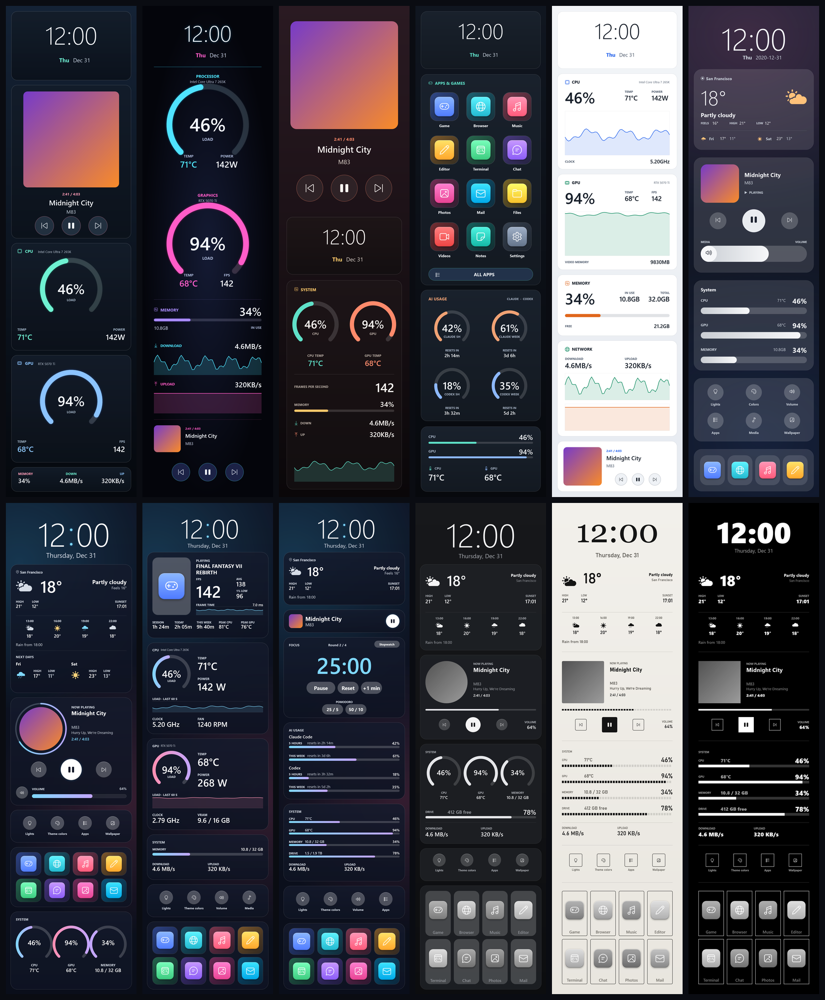

Every built-in and legacy theme has to pass an automated quality gate before it ships: every font found, nothing off screen, no overlapping text, readable contrast, with ordinary readings and with worst-case ones (100% loads, five-digit fan speeds, very long song titles).

## Recolor anything

Eighteen palettes recolor any theme on the fly without touching its files, and each theme remembers its own choice. Light themes are handled too: their cards become the palette's dark surfaces and their text stays readable. Step through palettes from the tray, a hotkey, or the Colors page on the HUD.


## Touch pages

Turn click-through off and the HUD becomes a control surface. Tap the album art for the music player, a gauge for sensor history, a toggle for lights or volume. On a mouse-only setup the same pages work with clicks. They are sized for a finger at arm's length and drawn in the Lumen look whatever theme you run.

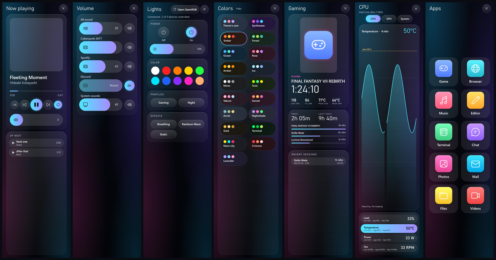

| Page | What it does |
|---|---|
| **Now playing** | Art, title and artist, play / pause / skip for any app that uses Windows media controls. With Plexamp: seek, shuffle, repeat, volume and the play queue. |
| **Volume** | A slider and mute for the system and for each app making sound. |
| **Lights** | Your OpenRGB setup: on / off, brightness, ten colors, your saved profiles and effects. |
| **Colors** | The palettes, as big tiles. |
| **Gaming** | The current or last game, session length, average FPS, 1% low, peak temperatures, play time today and over seven days, recent sessions. |
| **Sensor details** | Load, temperature, power and fan for CPU, GPU and system, each with min / avg / max and a four-minute chart with its alert level. |
| **Apps** | A paged drawer of up to 48 shortcuts: games, programs, folders, links, key presses, lock and sleep. |

The same pages on the bar:

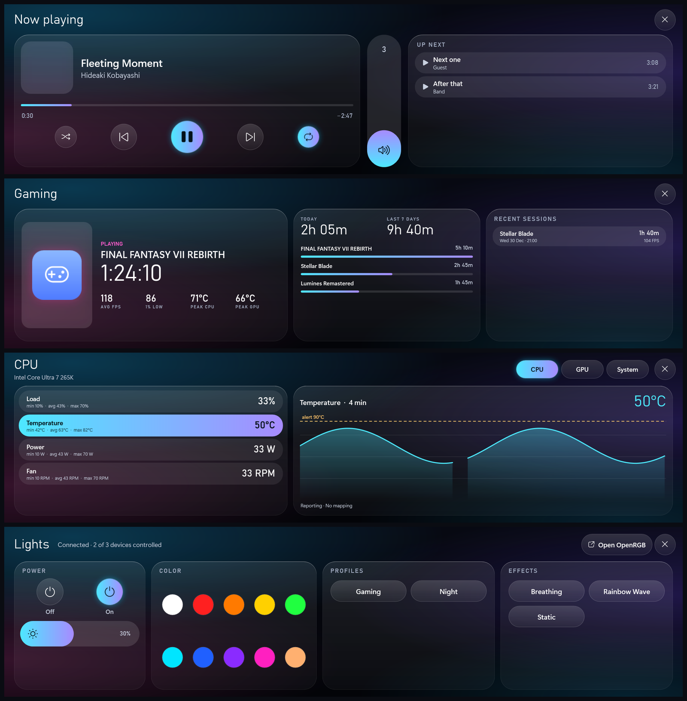

On a touch screen Lumen HUD handles the finger itself, so a tap doesn't drag your mouse cursor onto the HUD. Swipe sideways to change theme. Tray → Touch screen setup and **Keep other windows off this display** fix the usual touch-panel annoyances.

## What it can show

**Hardware (through HWiNFO).** CPU and GPU load, temperature, power, clock, voltage and fans; memory and VRAM used of total; drive activity, temperature and space; pump and case fans; download and upload. Sensor Manager's **Auto-pair** maps them for you. Readings turn amber and red at real limits (CPU 90 / 98 °C, GPU 83 / 90 °C, memory and drives nearly full), busy alone never warns, and if HWiNFO stops updating the readings dim instead of showing a stale number as live.

**Performance.** FPS, average FPS and frame time. Pair RivaTuner Statistics Server's frame time and 1% low in HWiNFO and Lumen HUD uses those; otherwise frame time is worked out from FPS. Optional HWiNFO limit sensors show THERMAL, POWER or VOLTAGE LIMIT tags when something is being held back.

**Games.** Lumen HUD finds your library (Steam, GOG, Xbox, games Windows knows about, and any you add), notices when one is running, and records sessions: length, average FPS, 1% low and peak temperatures, with play time per day and week. It asks once before tracking a full-screen program it doesn't recognize.

**Music.** Whatever is playing through Windows media controls, with art. Plexamp gets a progress ring, time played and the queue.

**Weather.** Current conditions, feels-like, high and low, the next hours, the next days, rain in the next twelve hours and the next sunrise or sunset, from Open-Meteo. No account or key.

**AI plan usage.** Claude Code and Codex 5-hour and weekly limits, with when each resets. Codex needs no setup. Claude is opt-in, either from the Claude desktop app's sign-in or by connecting Lumen HUD as Claude Code's terminal status line.

**Time.** Clocks and dates in several formats, a timer, a stopwatch and Pomodoro rounds (25 / 5 and 50 / 10).

**Shortcuts.** Up to 48 tiles that open games, programs, folders and links or send keys. Import your Steam library with covers, or drag and drop onto the Shortcuts window or straight onto the HUD's tiles. Separate Gaming and Productivity lists let the gaming and work themes show different docks.

## It changes with what you're doing

- **While gaming.** Choose a theme to show whenever a game runs, with per-game overrides. Your own theme comes back when the session ends.
- **On a schedule.** Up to sixteen rules can show a theme, switch your LEDs, dim the screen or turn it off at set times and days. Night dimming also lowers the panel's backlight where the display supports it, and restores it afterwards, even after a crash.
- **Playlist.** Rotate through themes on a timer.
- **Hotkeys.** Bind up to 32 key combinations to any action: step themes, the next palette, open a page, toggle lights, show a particular theme, launch a shortcut. They work from inside any app or game.
- **Aesthetic mode.** Fade the HUD to 10–40% or hide it to show off your wallpaper; a tap brings it back for a minute.
- **Tray double-click.** Yours to assign.

When several want a say, the order is: your own pick, then the game, then the schedule, then the playlist.

## Build your own theme

The editor is drag and drop, with snapping, nudging, undo and redo, and sample or live values while you work.

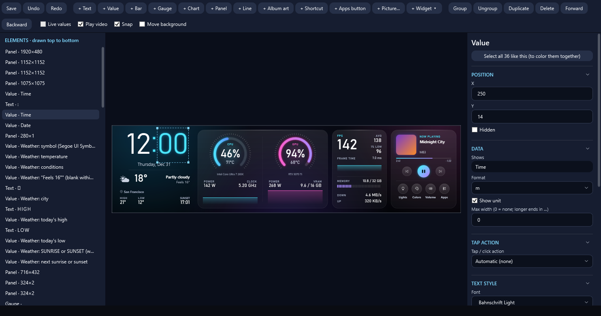

- **Ten kinds of element:** text, readings, bars, gauges, charts, panels, lines, pictures, album art and shortcut tiles.
- **Ready-made widgets:** clock, weather, now playing, gaming, lights, volume, quick toggles, dock and more, dropped in as a group you can move and scale together.
- **Backgrounds:** a color, a picture or a looping video, with fit, zoom and position. Or leave it see-through.
- **Warning colors:** per element: at what value it turns amber and red, or which other reading decides.
- **Tap actions:** what each element does when touched: open a page, control media, start a timer, switch theme.
- **Color tools:** change a color everywhere it is used, by role, keeping each use's opacity.
- **Any size:** presets for the screens above, or type your own.
- **L-Connect import:** bring in Lian Li L-Connect 3 `.template` and `.zip` themes, video backgrounds included.
- **Your fonts:** anything installed in Windows, plus a fonts folder of Lumen HUD's own.

Themes are plain `theme.json` files in a folder, so they are easy to back up and share.

## Getting started

1. **Install HWiNFO** and, in its sensor settings, turn on reporting to the **HWiNFO Gadget** for the readings you want. Lumen HUD reads what HWiNFO publishes there.
2. **Download** the latest [release](https://github.com/kasualty21/Pulsewave-HUD/releases/latest), unzip it into a permanent folder and run `LumenHUD.exe`. It lives in the notification area.
3. **Pick the display:** tray → Display selection. Lumen HUD remembers the monitor itself, not its number, and recovers when it disconnects and returns.
4. **Map the sensors:** tray → Sensor Manager → Auto-pair, then adjust anything it guessed wrong.
5. **Pick a theme:** it starts on Lumen Lifestyle; tray → Themes for the others.
6. **For touch or clicks,** turn off tray → Click-through.
7. **Optional:** tray → Launch with Windows, Shortcuts, Weather, Lights, Gaming, Schedule and Hotkeys.

OpenRGB lights need OpenRGB's SDK server running; see [docs/OpenRGB-Setup.md](docs/OpenRGB-Setup.md). For upgrade notes between versions, see [src/README.md](src/README.md).

Lumen's numerals use Bahnschrift, which ships with Windows 10 and 11.

## Privacy and safety

- **It never captures your screen, apps or games.** Everything shown comes from sensors, Windows' public media and audio APIs, and files you point it at.
- **Settings stay on your PC,** in `%LOCALAPPDATA%\Lumen HUD`. Saves are atomic with a backup, and a damaged settings file is kept rather than silently replaced.
- **Network use is narrow and opt-in:** Open-Meteo for weather once you set a city; your own Plex server and the local Plexamp player if you enter a Plex token (stored encrypted with Windows DPAPI, sent only to Plex and local-network servers); `api.anthropic.com` only if you turn on Claude usage from your sign-in, saving nothing but percentages.
- **Lights are controlled only when you ask:** a tap, a click or a schedule you made. Lumen HUD talks to OpenRGB on this PC only, with a short list of allowed commands, and never saves over your OpenRGB profiles.
- **No administrator rights.** Startup registration is per-user and yours to switch on.

## Building from source

You need the .NET 10 SDK on Windows.

Compile:

```powershell
dotnet build .\src\Pulsewave\Pulsewave.csproj -c Release
```

Run the regression suite (444 checks; it builds into a new folder under `work\test-runs`, so a running Lumen HUD never blocks it):

```powershell
powershell.exe -NoProfile -ExecutionPolicy Bypass -File .\scripts\Run-Tests.ps1
```

Publish a self-contained Windows x64 executable:

```powershell
powershell.exe -NoProfile -ExecutionPolicy Bypass -File .\src\build-win-x64.ps1
```

The suite renders every theme and page off-screen and never launches the real overlay, edits your settings, changes startup entries or touches display topology.

## Project layout

Development is coordinated through the files below; contributors (human or agent) should read `AGENTS.md` first.

- `src/`: the application (`src/Pulsewave`: the folder and code namespace keep the old name), its regression checks (`src/Tests`) and upgrade notes.
- `docs/DESIGN.md`: the Lumen design baseline: tokens, components and rules for new visual work.
- `docs/ROADMAP.md`: milestones and what is planned.
- `docs/TEAM.md` and `docs/BOARD.md`: ownership rules and task state.
- `docs/RECAP.md`: implementation and validation history.
- `docs/validation/`: release evidence (build and package hashes) and the device acceptance checklist, `V0.9.1-ACCEPTANCE.md`.
- `docs/images/`: the pictures on this page, built by rendering themes and pages with sample readings.
- `scripts/`: the test runner, the release gate, the logo (`make-logo.py`) and the generator for legacy templates 01–25. Templates 26–45 are generated by `src/Tests/Themes`; 01–39 live in `src/Pulsewave/Templates/Legacy`.
- `releases/` and `work/`: local packages and scratch files, not tracked in git.

The latest release is V0.14.0, the first as Lumen HUD; its evidence is in [docs/validation/V0.14.0-release-evidence.md](docs/validation/V0.14.0-release-evidence.md). Lumen was checked on a HYTE Y70; the 8.8" bar layouts of Lumen have so far been checked in automated renders only.
